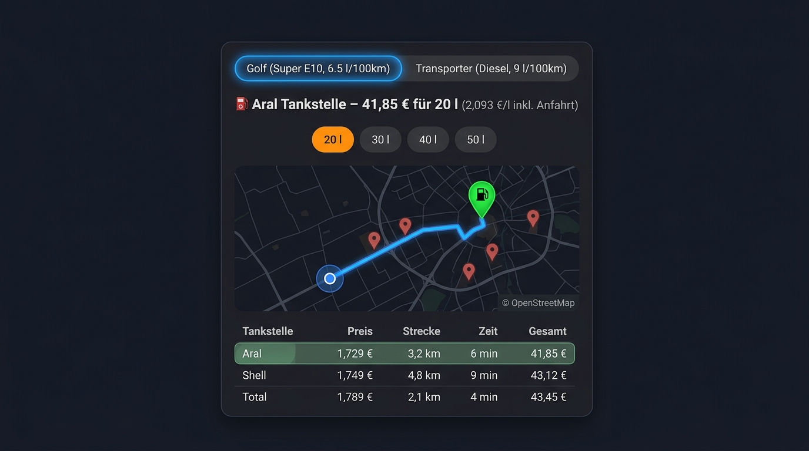

# Spritkarte – Tankempfehlung für Home Assistant



Empfiehlt die günstigste Tankstelle unter Berücksichtigung von **Preis**, **Fahrstrecke** (Routing via OpenRouteService) und **Tankmenge**. Anzeige auf einer OpenStreetMap-Karte.

## Funktionsweise
- Preise kommen aus bestehenden Sensoren (z. B. der **Tankerkönig**-Integration). Die Sensoren brauchen die Attribute `latitude`/`longitude` (Tankerkönig liefert sie).
- Routen (Distanz, Fahrzeit, Geometrie) werden per ORS-Directions-API **nur bei Bedarf** berechnet – für neue Tankstellen oder einen geänderten Startpunkt (gerundet auf ca. 100 m) – und dauerhaft gespeichert. Normale Updates holen nur noch die Preise.
- **Aktualisierungsintervall:** Das Intervall (Standard 15 min) dient ausschließlich dazu, die **Preise** der Tankstellen-Sensoren neu einzulesen und die Empfehlung neu zu berechnen. Die Routen werden dadurch **nicht** neu berechnet, sondern aus dem Cache verwendet (es erfolgen keine OpenRouteService-Anfragen). Neu berechnet wird nur bei einer neuen Tankstelle, einem geänderten Startpunkt oder manuell (siehe unten).
- **Manuell neu berechnen:** Button `button.spritkarte_routen_neu_berechnen` oder Service `spritkarte.recalculate`.
- **Mehrere Fahrzeuge:** Jedes Fahrzeug hat Name, Kraftstoffsorte (E5/E10/Diesel) und Verbrauch. Verwaltung unter *Einstellungen → Geräte & Dienste → Spritkarte → Konfigurieren* (Fahrzeug hinzufügen / bearbeiten / löschen). Du kannst Preis-Sensoren aller Sorten gemischt auswählen; jedes Fahrzeug nutzt nur die Tankstellen-Sensoren seiner Sorte (erkannt über das Attribut `fuel_type` bzw. die Entity-ID). Routen werden einmal je Standort berechnet und von allen Fahrzeugen geteilt.
- Sensoren: `sensor.spritkarte_tankempfehlung` (alle Fahrzeuge, für die Karte) und je Fahrzeug ein kompakter Sensor `sensor.spritkarte_tankempfehlung_<name>` für Automationen.
- Die Karte zeigt bei mehreren Fahrzeugen Tabs; optional `vehicle: <Name>` setzt das Standard-Fahrzeug.
- Kosten je Menge `L`: `(L + Fahrstrecke · Verbrauch/100) · Preis`. Optional wird die Rückfahrt eingerechnet.

## Installation
1. Per **HACS**: *HACS → ⋮ → Benutzerdefinierte Repositories* → URL `https://github.com/haarspalter/ha-spritkarte`, Kategorie **Integration** (nicht „Dashboard/Plugin“ – die Karte wird von der Integration mitgeliefert) → herunterladen. Manuell: Ordner `custom_components/spritkarte` nach `<config>/custom_components/` kopieren. Danach HA neu starten.
2. Kostenlosen API-Key bei https://openrouteservice.org holen.
3. *Einstellungen → Geräte & Dienste → Integration hinzufügen → Spritkarte*: API-Key, Preis-Sensoren (alle Sorten gemischt möglich), Mengen (z. B. `20, 40`) sowie das erste Fahrzeug (Name, Kraftstoffsorte, Verbrauch).
4. Karte zum Dashboard hinzufügen – am einfachsten **visuell**:
   - Dashboard im Bearbeitungsmodus öffnen → *Karte hinzufügen* → **„Spritkarte“** auswählen (mit Live-Vorschau).
   - Im visuellen Editor Sensor, Standard-Fahrzeug, Standard-Tankmenge und Kartenhöhe einstellen.

   Alternativ per YAML (optional, z. B. für `tile_url`):

```yaml
type: custom:spritkarte-card
entity: sensor.spritkarte_tankempfehlung
vehicle: Golf     # optional, Standard-Fahrzeug (Name)
amount: 40        # optional, Standard-Tankmenge
map_height: 350   # optional
tile_url: https://tile.openstreetmap.org/{z}/{x}/{y}.png   # optional
```

Die JS-Datei wird von der Integration automatisch geladen (kein Ressourceneintrag nötig). Leaflet wird per CDN (unpkg) geladen.

## Hinweise
- Kartenkacheln: `tile.openstreetmap.org` – nur für geringe Last erlaubt (OSM Tile Usage Policy).

## Nutzungsbedingungen openrouteservice (HeiGIT)
Es gelten die [Terms of Service](https://account.heigit.org/info/tos). Umsetzung bzw. Pflichten für dich:
- **Attribution:** Die Karte zeigt „© openrouteservice by HeiGIT | Data from OpenStreetMap“. Entferne sie nicht. Werden Routen/Ergebnisse weitergegeben, gilt **CC-BY-SA 4.0** (ORS-Ergebnisse) und die ODbL/OSM-Lizenz.
- **Ein Account pro Person**, kein Teilen/Mehrfach-Anmelden von Keys.
- **Limits:** Routen werden nur bei Bedarf berechnet und gecacht, Anfragen werden gedrosselt (ca. 1 Request / 1,6 s). Bei HTTP 429 pausiert die Integration 1 Stunde, statt weiter anzufragen. Löse „Routen neu berechnen“ nicht häufig aus.
- **Keine personenbezogenen Daten:** Der Startpunkt wird nur auf ca. 100 m gerundet übertragen. Empfehlung: feste Zone/Position als Startpunkt statt eines bewegten `device_tracker` verwenden (jede Positionsänderung > 100 m löst neue Anfragen aus).
- **Haftung/Sicherheit:** Routen basieren auf OSM-Daten und können fehlerhaft sein; Fahrzeit und Strecke sind unverbindlich. Kein Einsatz für sicherheitskritische Navigation. Das kostenlose Kontingent ist nicht für kommerzielle Weitergabe gedacht – dafür einen passenden [Plan](https://account.heigit.org/info/plans) wählen.

